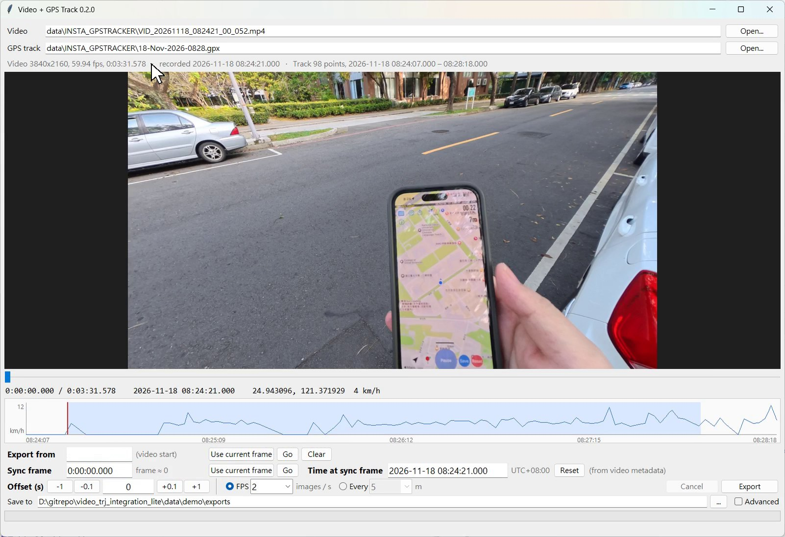

# video_trj_integration_lite

單一影片 × GPX / NMEA 軌跡的時間對準與抽圖工具（桌面 UI + CLI）。依固定頻率或固定距離從影片抽出照片，每張照片附上內插的 WGS84 座標，輸出 CSV，並可寫入 EXIF GPS（Metashape、COLMAP 等可直接讀取）。

[](https://thethingteam.github.io/VideoTrjLite/)

👉 [線上操作介紹](https://thethingteam.github.io/VideoTrjLite/)

架構說明見 [ARCHITECTURE.md](ARCHITECTURE.md)。

## 支援平台

| 平台 | 狀態 | 說明 |
|---|---|---|
| Windows x64 | ✅ 已驗證 | EXE 與從原始碼執行皆可 |
| Linux | ⚠️ 尚未驗證 | 僅能從原始碼執行；程式已依跨平台方式撰寫，但尚未在 Linux 上實際測試 |

## 使用 EXE（Windows x64，不需安裝 Python）

執行 `VideoTrjLite.exe`，或把影片與 GPX/NMEA 檔直接拖到 EXE 上。單一檔案，首次啟動需數秒解壓。

## 從原始碼執行

需要 Python 3.10 以上。

```powershell
python -m venv .venv
.venv\Scripts\python.exe -m pip install -r requirements.txt
.\run_ui.bat
```

Linux（⚠️ 尚未驗證；EXE 只提供 Windows x64 版，Linux 從原始碼執行）：

```bash
sudo apt install python3-venv python3-tk   # Debian / Ubuntu；其他發行版請裝對應的 Tk 套件
python3 -m venv .venv
.venv/bin/python -m pip install -r requirements.txt
./run_ui.sh
```

之後各節的指令在 Linux 上把 `.venv\Scripts\python.exe` 換成 `.venv/bin/python` 即可。

選配：`pip install opencv-python` 作為 PyAV 打不開檔案時的備援解碼器。

## 打包 EXE

```powershell
.venv\Scripts\python.exe -m pip install -r requirements-dev.txt
packaging\build_exe.bat
```

產生兩個單檔 EXE（含 FFmpeg，不含 OpenCV 備援）：

- `dist\VideoTrjLite.exe`：桌面 UI。
- `dist\vtl.exe`：命令列版，例如 `vtl.exe export --video ...`。cmd / PowerShell 會等它結束並取得 exit code，批次檔與腳本請用這個（UI 版不會讓主控台等待）。

## 支援格式

- **軌跡**：GPX 1.0 / 1.1（`trk`，沒有時退回 `rte` / `wpt`）；NMEA 0183 的 RMC、GGA、GNS、ZDA，任何 talker（GP/GN/GL/GA/BD…）。NMEA 只有 GGA 沒有日期時，載入時會詢問錄影日期（CLI 用 `--date`）。
- **影片**：以 PyAV（內含 FFmpeg）解碼，已測 H.264、HEVC（含 10-bit）、VP9、AV1、ProRes、MJPEG、MPEG-2 TS，容器 mp4/mov/mkv/webm/avi/mts/ts 等；支援 VFR 與旋轉 metadata。

## UI 操作

`畫面時間 = 對時影格的時間 + (播放位置 − 對時影格) + Offset`

1. 拖入（或 `Open...`）影片與 GPS 軌跡。NMEA 沒有日期時會跳出視窗詢問錄影日期。
2. **Export from**（開始輸出影格）：拖到要開始出圖的畫面，按 `Use current frame`。第一張照片就是這一格，之後依 FPS 或距離往後輸出。空白 = 從影片開頭；`Go` 跳到該格、`Clear` 清除。
3. **Sync frame**（對時影格）＋ **Time at sync frame**（該格的時鐘時間）：
   - 拖到一個知道確切時間的畫面（例如拍到 GPS 時鐘、紅綠燈起步），按 `Use current frame`，再把右邊的時間改成該畫面的實際時間。
   - 時間可輸入 `15:00:20`、`2026-11-18 15:00:20.5`、`下午 03:00:20`，依右側顯示的時區；只輸入時間時日期取軌跡的日期。
   - 預設對時影格是第一格，時間自動帶入影片 metadata 的開始時間（沒有時用軌跡起點），旁邊會註明來源。按 `Reset` 改回自動值。
   - 對時影格與開始輸出影格互相獨立：可以用影片後段的時鐘畫面對時，但從前段開始輸出。
   - 兩個欄位都可直接輸入影片位置，例如 `12.5` 或 `0:01:02.500`；旁邊顯示約略的影格編號。
4. **Offset (s)**：微調用（−1 / −0.1 / +0.1 / +1，或輸入 `-12.5`、`+8:00:00`）。預覽下方即時顯示目前畫面的時間、座標與速度；速度曲線的紅線是目前畫面。
5. 輸出方式（二選一）：
   - **FPS**：每秒輸出幾張照片（可小數，0.5 = 每 2 秒 1 張）。
   - **Every N m**：沿軌跡每移動 N 公尺輸出一張（需載入軌跡）。停車時不出圖；距離沿路徑累計，精度約一格影片的移動量；GPS 斷訊後重新起算，斷訊後的第一格一定輸出。
6. 按 `Export`。

鍵盤：←/→ 一格、Shift+←/→ 1 秒、Ctrl+←/→ 10 秒；點速度曲線可跳到該時刻。

同一支影片的開始 / 結束輸出位置、對時影格與時間、Offset、FPS / 距離設定會自動記住（Windows：`%APPDATA%\video_trj_integration_lite\alignments.json`；Linux：`~/.config/video_trj_integration_lite/alignments.json`）。

### Advanced（勾選後展開）

| 欄位 | 說明 |
|---|---|
| Timezone | 對時時間與檔名使用的時區（預設系統時區）；GPX/NMEA 內部一律 UTC |
| Max GPS gap (s) | 前後軌跡點間隔超過此值（或跨 GPX segment）不內插，略過該時刻（預設 3） |
| Min movement (m) | FPS 模式下，與上一張保留照片的最小水平距離，0 = 停用（距離模式不使用） |
| Export to | 輸出到影片的這個位置為止（空白 = 到結尾） |
| Format / EXIF GPS | jpg（品質 95）或 png；EXIF 寫入 GPS、拍攝時間、速度、航向 |

雙錨點（時鐘漂移修正）只在 CLI 提供（`--anchor2-pts/--anchor2-time`）。

不載入軌跡也能匯出；沒有時間基準時以影片經過時間命名。

## 輸出

每次匯出建立新資料夾，不覆寫：

```
<output>/vtl_YYYYMMDD_HHMMSS/
├─ images/YYYYMMDD_HHMMSSmmm.jpg   # 依設定時區命名，含毫秒
├─ frames.csv                      # image_file, video_pts, utc_time, local_time, latitude, longitude,
│                                  # altitude, speed_mps, course_deg, fix, hdop, ref_time_pre, ref_time_next
├─ skipped.csv                     # 略過的時刻與原因
├─ alignment.json                  # 本次對準參數
└─ run_summary.json                # 影片、軌跡、設定與統計
```

每張照片的時間、座標、EXIF 與檔名都對應實際寫出的那一格影片（`video_pts`），不是排程的理論時刻。

略過原因：`outside_coverage`（理論上不會出現，匯出範圍已裁到軌跡內）、`gnss_gap`、`below_min_movement`、`frame_unavailable`、`duplicate_frame`（距離模式下兩個時刻落在同一格，只輸出一次）。

## CLI

```powershell
.venv\Scripts\python.exe main.py probe --video in.mp4
.venv\Scripts\python.exe main.py track-info --track log.nmea --tz +08:00
.venv\Scripts\python.exe main.py export --video in.mp4 --track log.gpx --anchor-pts 12.345 --anchor-time "15:54:58.80" --tz +08:00 --rate 2 --out D:\out
```

其他參數：`--distance 5`（每 5 公尺一張，取代 `--rate`）、`--anchor2-pts/--anchor2-time`（雙錨點）、`--use-metadata`、`--offset`、`--date`、`--start-offset`、`--in-pts/--out-pts`（只裁切範圍，取樣格點仍通過錨點）、`--max-gap`、`--min-move`、`--format`、`--no-exif`。

## 測試

```powershell
.venv\Scripts\python.exe -m unittest discover -s tests -v
```

測試會即時產生合成影片（含 VFR、旋轉、MPEG-TS）與 GPX/NMEA，不需要外部檔案。

## 專案結構

```
main.py          入口（UI / CLI）
vtl/             核心：軌跡、影片、對時、取樣、匯出（不依賴 GUI）
vtl_ui/          Tkinter 介面
tests/           unittest
packaging/       PyInstaller spec 與打包腳本
docs/            操作介紹網頁（GitHub Pages）與 README 截圖
```

`data/`、匯出結果（`vtl_*/`）與影片 / 軌跡檔已列在 `.gitignore`，不會進 repo。

## 授權

本專案原始碼以 [MIT License](LICENSE) 釋出。

第三方元件各依其授權：PyAV（BSD-3-Clause）、NumPy（BSD-3-Clause）、Pillow（MIT-CMU）、piexif（MIT）、tkinterdnd2（MIT）、OpenCV（Apache-2.0，選配）。

打包出的 EXE 內含 PyAV wheel 附帶的 FFmpeg（LGPL v3 以上）以及 libx264、libx265（GPL v2 以上）等函式庫，因此**散佈 EXE 時須遵守 GPL 的條件**（附上授權條款並提供對應原始碼）；MIT 只適用於本專案自己的原始碼。
